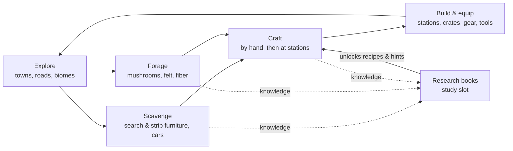
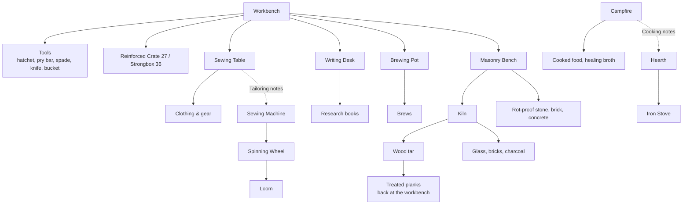

# Mycelium: a beginner's guide

*What playing the game looks like today, from your first minute to the end
of what's built. Written 2026-10-01 (end of day 2). Exact recipes, drops and
loot chances are in item_reference.md (source document); the design
intent is in gdd.md (source document).*

---
## The idea in one paragraph

The world ended slowly. A fungal network crept through the towns, people
left in a hurry, and the mycelium is still spreading. You wake up in a town
with nothing. You **scavenge** what people left behind, **forage** the fungi
that replaced them, and **turn both into tools, gear, food and shelter**.
Everything you do teaches you something, but you only *keep* that knowledge
by writing it down in **research books**. Those books open up better recipes
and eventually materials the fungus can't eat.

## The loop

Every arrow is something you do with your hands. Nothing is handed to you
as a menu: a hand recipe only **comes to mind once you've held one of its
ingredients**, and a station shows what it can make when you stand at it.

---
## Controls

| Action | Controller | Keyboard / mouse |
|---|---|---|
| Move / look | Left stick / right stick | WASD / mouse |
| Jump | A | Space |
| Sprint | L3 (toggle) | Shift (hold) |
| Break / take apart | RT (hold) | Left mouse (hold) |
| Place / use held item (eat, drink, fill bucket) | LT (hold) | Right mouse |
| Interact: search, pick, sit, open, use station | X | E |
| Hotbar | LB / RB | Mouse wheel, 1–9 |
| Inventory | Y | Tab / I |
| Character screen (Character, Crafting, Research) | View | C |
| Switch tabs | LB / RB | Q / E |
| Pause, settings | Start | Esc |
| Screenshot (to `screenshots/` in the game's data folder) | Share | F12 |

In the inventory: **A** picks up / swaps, **X** (right-click) splits a stack,
**RB** (shift-click) moves a stack between your pack and an open crate,
**LB** (Q) drops it on the ground.

---
## Progression, stage by stage

### 0. The first ten minutes: scavenge

You start in a town. Before crafting anything:

- **Search furniture (X).** Fridges, kitchen counters, dressers, bookshelves,
  store shelves and crates all hold something: food, cloth, clothes, books,
  batteries, scrap. Each piece of furniture is searched once, and stays open
  afterwards so you can see what you've been through. Now and then a house
  has **better furniture**: a side-by-side fridge with better food, a
  wardrobe of better clothes, a flatscreen TV full of electronic parts, a
  patterned sofa or an upholstered armchair.
- **Take furniture apart (hold RT on it).** This is the main source of
  **scrap metal**, **copper wire** and **glass shards**. A TV gives a
  **circuit board** (and teaches electronics); sofas, beds and armchairs
  give **cloth**.
- **Eat.** Hunger drains over about 40 minutes. Found food has a tier: *Rot*
  and *Spent* food fills you less and may make you sick. Hold LT to eat.
- **Forage (X).** Mushrooms grow outdoors and inside ruined buildings. You
  don't know which are safe until you eat one (or have Mycology notes).
  Pale **mycelium patches** scrape up as **hyphal felt**.
- **Cars on the roads** between towns can be searched (glovebox, boot) and
  stripped for scrap, wire, glass and a battery.

### 1. Crafting by hand (Character screen → Crafting)

Things you can make anywhere, once you've held an ingredient:

| Make | From | Why |
|---|---|---|
| Cloth ×3 | Clothes | The basic soft material |
| Cloth | 3 hyphal felt | Cloth from the fungus itself |
| Planks ×4 | Log (from trees) | The basic hard material |
| Torch ×2 | Planks + cloth (or 2 plant fiber) | Light; never burns out |
| Bandage | 2 cloth | Healing |
| Storage Crate (18 slots) | 6 planks | Your first stash |
| Campfire | 3 planks + 4 stone | Cooking station |
| **Workbench** | **8 planks + 2 scrap metal** | **The gateway to everything else** |

Crafting takes a moment (a progress bar). Hold A to keep making more.

### 2. The workbench: tools and the other stations

Place the workbench and use it (X). From here the game branches:

- **Tools** make work faster and wear out. A hatchet is for wood, a pry bar
  for taking furniture apart, a spade for soil, sand and gravel. Uses left
  show on the slot. A worn-out tool breaks back into scrap. Repair them at the
  workbench.
- **Bucket:** hold LT at open water to fill it. You need a bucket of water
  for brewing.

### 3. The branches (any order)

**Tailoring: from a needle to a loom.** Each rung needs a better Tailoring
book (see the research table below). Wear what you make in the gear slots on
the Character tab (the pop-up compares stats with what you're wearing), or
just hold it and press LT.
*(Gear stats don't do anything yet; see "Not in yet" below.)*

| Station | Built at | Needs | Makes |
|---|---|---|---|
| Sewing table | Workbench | — | Spore gear by hand: hood, wraps, trousers, boots, satchel, padded jacket; mends clothes |
| Sewing machine | Workbench | Tailoring 1 (Spore) | Sprout gear with **yarn**; Mycelial clothes and a Fruiting jacket from **fabric** (Tailoring 3) |
| Spinning wheel | Workbench | Tailoring 2 (Sprout) | **Yarn** from plant fiber, hyphal felt or rags |
| Cutting table | Workbench | Tailoring 2 (Sprout) | **Unpicks** gear you don't want back into about half its cloth, yarn and fabric; cleaner cuts of clothes and carpet |
| Loom | Workbench | Tailoring 3 (Mycelial) | **Woven fabric** from yarn |
| Textile machine | Workbench | Tailoring 4 (Fruiting) + an electric motor | Fabric three at a time; **Fruiting** gear |

Before you have a wheel you can twist 3 plant fiber into a yarn by hand,
slowly.

**Cooking: from a campfire to a kitchen range.**

| Station | Built at | Needs | Makes |
|---|---|---|---|
| Campfire | By hand | — | Roasted puffball, mushroom skewer, hot stew; healing broth (Mycology 2) |
| Hearth | Masonry bench | Cooking 1 (Spore) | Mushroom soup, **forager's stew** (Endurance for 5 min), a slow-cooked Mycelial stew |
| Iron stove | Workbench | Cooking 2 (Sprout) | Burns fuel: puffball bread, dried mushrooms; **mushroom pie** (Cooking 3: Regeneration for 2 min) |
| Smokehouse | Workbench | Cooking 3 (Mycelial) | Burns fuel: smoked mushrooms; **preserves** (needs a glass jar) |
| Kitchen range | Workbench | Cooking 4 (Fruiting) + heating elements, iron, car batteries | No fuel: **forager's feast** (Strength for 5 min), Fruiting pie and broth |

The best meals fill you more (higher tiers) and some leave a lasting effect,
like a brew.

**Metal: furnace → blast furnace** (Masonry). The furnace (Masonry 2,
masonry bench) melts 3 scrap or 2 pipes into an **iron ingot**, burning 2
fuel. The blast furnace (Masonry 4) turns 2 iron and 2 charcoal into
**steel**. Steel makes **steel tools** at the workbench: hatchet, pry bar and
spade, 60% faster and lasting about four times longer than scrap ones.

**Electronics bench** (Electronics 1, workbench). Salvage circuit boards into
**electronic parts** (TVs and car dashboards also give a few), then make the
battery lamp and **heating elements** (Electronics 2) and **electric
motors** (Electronics 3, needs iron). Motors drive the textile machine;
heating elements heat the kitchen range.

**Glass and alchemy: topics that open from others.** Some topics can't be
begun until other books know enough:

- **Glassworking** opens at **Masonry 3**. Melting glass in the kiln teaches
  it. The **glassblower's bench** (masonry bench, Glassworking 1, burns fuel)
  makes jars and bottles, then (Glassworking 2) flasks, a ground **lens**, and
  a **magnifier**: carry one and everything teaches you a quarter more.
- **Alchemy** opens at **Glassworking 2 + Mycology 2**. The **alembic**
  (glassblower's bench, Alchemy 1) **distils any brew you carry into a
  tincture**: a tier higher, half as strong again, and lasting two and a half
  times as long. At Alchemy 2 it makes an **antidote** that cures poison and
  sickness.

**Growing food (Cultivation).** Make a **planter** by hand (4 planks, 3
dirt), hold a potato, beans or greens seeds (wild seeds turn up when you
break grass) and press X on it. Crops grow over a day or two of game time;
X harvests them when ripe. **Compost** makes them grow faster and give more.
With Mycology too you can grow **mushrooms on a log**, and make
**mycorrhizal compost** for the best harvests.

**Crafts that need two fields.** Some things need you to know two fields:
a vacuum tube (Glassworking + Electronics), a **crank radio** (Electronics +
Communication), mycelium leather (Mycology + Tailoring), healing salve
(First Aid + Alchemy). The **Knowledge** tab on the Character screen maps
what you know and how the fields connect, without spoiling what's ahead.

**Power (Engineering).** With Carpentry 1 and Electronics 2 you can begin
Engineering notes, restore rusted pipes (sand at the workbench), rewind a
**dynamo** and build a **hand-crank generator**. Set down a **battery
bank** (Engineering 1) within 10 m: cranking charges it (and makes you
hungry), an **electric lamp** (Engineering 2) lights while there's charge,
and a **water wheel** (Engineering 3) beside water charges it by itself.
The kitchen range and textile machine need charge for everything they make.
**Mechanical parts** for generators come from cars and old tractors.
Hold a **multimeter** to see how far each bank reaches.

**Water and pipes.** Restored pipes join up by themselves with whatever
takes water. An **electric pump** (Engineering 2) set with its back to
water fills the **water tanks** piped to its front, while a battery bank
powers it. A brewing pot piped to a tank needs no bucket; an alembic piped
to one distils twice as fast. To go through a wall, aim at the wall right
behind your last pipe: the next one goes into it. Hold a **wrench** to see
the pipes and the flow, and to shut a valve.

**Steam.** At Engineering 3 (with Masonry 2) build a **boiler**, stoke it
with coal (from farmhouse fireplaces; charcoal and wood burn too) and pipe
it water from a tank. A **steam engine** (Engineering 4) beside it makes
far more power than a crank or a wheel, and an **accumulator rack** stores
two and a half times a battery bank and reaches 20 m.

**Solar.** Old solar panels sit on the flat roofs of shops and apartment
blocks: take them apart for solar cells and lithium cells. At Engineering 4
build **solar panels**: under open sky they charge your stores by day, for
nothing. The **lithium bank** (with Metallurgy 2) holds the most of any
store and reaches 40 m; its lights show how full it is.

**Mycodiesel and the stormcap.** At Mycology 4 build a **culture bench**
and grow mushroom strains in jars; with Alchemy, breed the **oil-cap
strain**. Seed a **bioreactor** with it, pipe it water and feed it plant
matter: it fills with **mycodiesel**, which runs a mycodiesel generator at
twice a diesel's output. The **stormcap**, a living battery, is the best
store there is: 4000, reaching 64 m.

**Mining.** Dig down: below a few blocks of dirt is stone, then dark deep
stone, and bedrock at the very bottom (y −48). Ore shows in the walls: coal
and copper near the top, tin, then iron in the deep stone, gold deeper, and
violet rare earths just above the bedrock. A **scrap pickaxe** (workbench)
gets ore out far faster than your hands; Mining notes unlock iron and steel
picks and, with Engineering, the **rock drill**, which runs on charge from
a battery bank. Smelt ore at the furnace; draw copper into wire. It's dark
underground: take a torch. Caves wind through the deep stone, and along the
roads in rocky country there are **quarries** (ore in the floors, carts to
search) and **old mines** (a timbered tunnel down to an ore chamber).

**Metallurgy** (Mining 2 + Masonry 2): bronze and solder, mechanical parts
from bronze, gold wire, precision circuits, **electrician's goggles** (see
power and pipes without holding anything), rare-earth magnets and the **ore
detector** (see ore through the rock); and, with Alchemy, iron into gold.

**Biodiesel.** Press beans into oil (oil press, Engineering 2 + Cultivation
1), distil potatoes into spirit at the alembic, and turn them into
biodiesel at a **fuel still** (Engineering 4 + Alchemy 1). A **diesel
generator**, built around the engine you pull out of a farm's rusted
tractor, burns it for twice the power of steam. The **tesla tower**
(Engineering 4 + Electronics 3) stores 600 and reaches 30 m, and sparks
while the power moves.

**Farmsteads.** Out along the country roads in open country you'll find old
farms: a farmhouse with a chimney (coal in the fireplace, bricks in the
chimney, a painting on the wall), a barn with hay and a workbench, and a
fenced field gone wild where feral potatoes, beans and greens still grow
(pick them for food and seed) around a rusted tractor (search it for an
almanac that teaches Cultivation; take it apart for mechanical parts).

**Writing desk: research.** This is the long game:

1. Make a **blank book** (an old book + cloth) and **ink** (2 inkcap mushrooms).
2. **Begin notes** on a topic: Mycology, Electronics, Carpentry, First Aid,
   Masonry, Cooking, Tailoring or Communication (writing at the desk teaches it) (and later Glassworking, Alchemy and
   Engineering, when other books know enough).
3. Put the book in the **study slot** (Character screen → Research tab).

Everything you do earns knowledge in its topic, whatever you're studying,
but doing the same thing over and over soon teaches nothing new, and
breaking a block you placed yourself teaches nothing at all: variety is how
you learn.
Breaking a TV is Electronics; picking mushrooms is Mycology; cooking is
Cooking; sewing, tearing up clothes or taking apart a sofa is Tailoring. Only a book of
that topic in the study slot writes it down, at **double rate** for the
topic you study. Anything else waits as *unwritten notes* until you study
that topic. Doing the same thing over and over teaches less; variety teaches
most. The desk can also **copy** a book and **transcribe** found journals
(15 pages) into the book you're studying.

A new book is **Spent**. Each level is a tier, so you can see at a glance
how much a book knows. **What a book has reached, you know for good**: its
unlocks stay yours wherever the book is kept afterwards (in your pack, on a
library shelf, at home). Books are where you write knowledge down, not
where it lives. The Knowledge tab shows what you know.

| Topic | Spore (8 pages) | Sprout (20) | Mycelial (40) | Fruiting (70) |
|---|---|---|---|---|
| Mycology | Hints whether an unknown mushroom is safe | Healing Broth; what each mushroom does in a brew | Warns you when a brew will go bad | **Culture bench**: mushroom strains |
| Electronics | **Electronics bench**; strip and salvage boards | Battery lamp, heating element | Electric motor | — |
| Carpentry | Bookshelf | Wardrobe, upholstered armchair | — | — |
| First Aid | Poultice (by hand) | Bandages heal half as much again | — | — |
| Masonry | Stone bricks, sealed brick, the kiln | Sealed concrete; **furnace** | Opens **Glassworking** | **Blast furnace** |
| Cooking | **Hearth** | **Iron stove** | **Smokehouse**; mushroom pie | **Kitchen range** |
| Tailoring | **Sewing machine** | **Spinning wheel** | **Loom**; Mycelial gear | **Textile machine** |
| Glassworking | **Glassblower's bench**: jars, bottles | Flasks, lens, magnifier; with Mycology 2 opens **Alchemy** | — | — |
| Alchemy | **Alembic**: tinctures | Antidote | — | — |
| Cultivation | Compost | Everything grows a quarter faster | Crops come up Sprout | One more at every harvest |
| Mining | Iron pickaxe; ore smelts | One ore in four doubles | Steel pickaxe | With Engineering 2: **rock drill** |
| Metallurgy | Bronze, solder; parts from bronze | Gold wire; precision circuits; **goggles** | Rare earths; iron into gold (with Alchemy 2) | Magnets; **ore detector** |
| Engineering | **Battery bank**, water tank, wrench, multimeter | **Electric lamp**, **electric pump** | **Water wheel**; boiler (with Masonry 2) | **Steam engine**, **accumulator rack**; powered stations draw half |
| Communication | **Library**: shelves for 18 research books | **A second study slot** | **Easel**: paintings to hang on walls | Copying takes half the time and ink |

**Brewing pot: brews.** A bucket of water plus 1–3 mushrooms makes two
brews. Each mushroom leans toward an effect: endurance, regeneration,
strength, night sight, deep lungs or luck. More of the same makes it
stronger. A poisonous agaric doubles its matching button mushroom (tan with
tan…). An agaric with no match, or two agarics, makes a **foul brew**
(poisoned, dizzy). Shelf fungus makes any brew last longer. You learn what a
mix does by **drinking it**; Mycology 2 notes reveal it in advance.

**Masonry bench → kiln: building to last.** The mycelium slowly turns
ordinary blocks next to it into overgrown versions, and vines climb
buildings. **Worked materials resist it:**

- Masonry bench: mortar (sand + gravel), dressed stone, scraping overgrowth
  off brick and concrete, then (Masonry 1–2) stone bricks, sealed brick and
  sealed concrete, plus stairs and slabs of each.
- Kiln (masonry bench, Masonry 1; every firing burns fuel: fiber, charcoal,
  coal, logs or planks): clay into **bricks**, sand or shards into **glass**, logs
  into **charcoal** and **wood tar**.
- Wood tar + planks at the workbench = **treated planks**, rot-proof wood.

From there the line runs on into metal (the furnace and blast furnace,
above) and glass.

---
## Where things come from

| Material | Where |
|---|---|
| Scrap metal | Taking apart fridges, counters, sinks, shelves, crates; cars |
| Copper wire | Fridges, TVs, crates, cars; stripping circuit boards (Electronics 1) |
| Glass shards | TVs, cars, glass doors |
| Cloth | Tearing clothes; sofas, beds, armchairs; counters, dressers; pressing felt |
| Yarn, fabric | Spun at the spinning wheel (or twisted by hand); woven at the loom |
| Books / journals | Bookshelves (journals are rare); some cars; library stacks |
| Old newspapers | Newspaper boxes, post boxes, mailboxes, phone boxes in town (read them: the last news) |
| Column base, shaft, capital | Masonry bench, from dressed stone (Masonry 1) |
| Rare books | Rare-book cases in libraries (two upstairs, four on the top floor); now and then stacks and museum cases |
| Bones | Taking apart a museum's dinosaur (14 to 24) |
| Rare-earth magnets | Stripping a hospital's MRI scanner (2) |
| Gold wire | Server racks (offices, data centres) |
| Ore samples | Museum mineral cases |
| Batteries | Cars (often), store shelves, counters |
| Logs | Trees: sparse on plains, thick in woodland, fungal ones in the Sporelands |
| Stone | Exposed outcrops (common in highlands), digging down |
| Sand, gravel | Beaches and river beds; old road surfaces |
| Clay | Lake and river beds |
| Plant fiber | Vines growing on buildings; grass tufts, reeds, ferns and other plants on the ground |
| Mushrooms | Everywhere; each biome favours different kinds |

---
## Staying alive

- **Hunger** drains over about 40 minutes (faster when sprinting or sick). At
  zero you starve. Above 60 hunger, **health** slowly comes back.
- **Sickness** comes from rotten food and unknown mushrooms. You learn each
  mushroom's edibility by eating it (or from Mycology notes).
- **Breath:** about 20 seconds under water.
- **Falls** over 4 blocks hurt, more the further you fall; water breaks a fall.
- **Night** is dark. Torches and campfires never burn out. Beds let you sleep;
  chairs let you sit.
- Status effects (good and bad) show as icons on the HUD.

## The world

- **Biomes:** plains, woodland, wetland, highlands and the **Sporelands**
  (giant mushrooms, glowing caps, dense fungus). Each changes the trees,
  rocks, fungi and what you find along the roads.
- **Towns** are grids of houses, shops and apartment blocks in different
  states of ruin and overgrowth. Each has stairs, furniture and loot.
- **Every town has a landmark**, bigger towns two or three: a **museum** (a
  dinosaur skeleton under the skylight, glass cases of minerals, history
  and old machines), a **library** (stacks, reading tables, rare books) and
  a **hospital** (a pharmacy, wards, MRI scanners with rare-earth magnets in
  them). Three storeys round an open atrium and a roof you can walk on:
  explore them top to bottom. Towns also have **office blocks** and **data
  centres** (server racks: gold wire).
- Every building, floor by floor, with what's in it: `docs/buildings.md`.
- **Country roads** join the towns: asphalt near town, decaying to gravel and
  dirt tracks out in the wild. Along them you'll find bridges, wetland
  boardwalks, abandoned cars (lines of evacuation traffic on the plains),
  fallen logs, rockfalls, cairns, fungal mounds, and the odd lone house or shop.
- **The spread:** fungus slowly converts blocks next to it and vines climb
  walls, around you as you play.

## Item tiers

Rot → Spent → **Spore** → Sprout → Mycelial → Fruiting → Bloom. The tier
shows as a name prefix and a coloured mark. For food it scales how much it
fills you; for books it shows how much they know.

---
## Not in yet (where progression stops today)

- **Gear stats have no effect.** Warmth, protection and carrying are shown
  and compared, but nothing reads them yet.
- **Seeing the Unseen** is a status effect with no perception layer behind it.
- **No threats yet:** no creatures, weather or temperature, so gear and food
  quality matter less than they will.
- **Towns don't have stories yet** (biome plan step 3: how each one was
  abandoned) or **landmark buildings** (step 4: lumber mill, pumping station,
  quarry works, greenhouse; farmsteads are in).
- **Ladders still to build:** Carpentry (carpenter's bench, lathe: it still
  tops out at level 2), Electronics' level 4, the upper levels of
  Glassworking and Alchemy, and the electric tools steel and motors point to.
- **Power has nothing big to run yet** beyond lamps, pumps, the drill and
  two stations: no electric tools, automation or machines that need the
  stormcap's 4000.

## Things this guide turned up

Writing the progression out end to end shows a few gaps worth looking at:

- **The writing desk needs a glass shard**, and shards only come from taking
  apart TVs, cars, glass doors or another desk. A new player may stall here
  without knowing why.
- **Clay is the gate to the kiln** (2 clay plus 8 bricks), and clay only sits
  in lake and river beds, so a dry start could make it hard to find. (The 8
  bricks are easier: scrape overgrown brick walls at the masonry bench.)
- **Carpentry is short** (one unlock), while Masonry, Cooking and
  Tailoring now run all the way to Fruiting.
- ~~Tools have no tier above scrap~~: steel tools now (blast furnace).
- In the item reference, the **leaves** block shows with no name.
